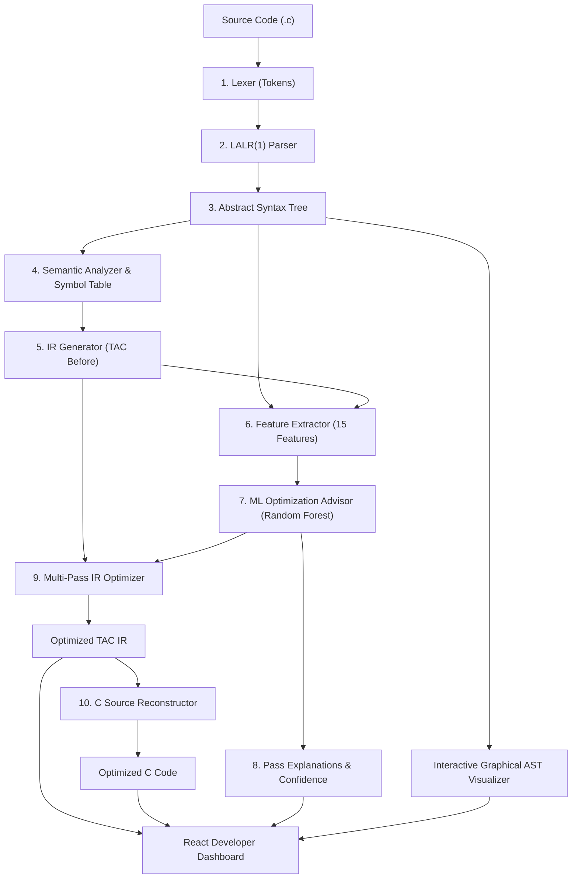

# OptiML — ML-Powered Compiler Optimization Advisor

[](file:///d:/B.Tech%201st%20year/Sem-7/PCD/PCD_Assignment/backend)
[](file:///d:/B.Tech%201st%20year/Sem-7/PCD/PCD_Assignment/backend)
[](file:///d:/B.Tech%201st%20year/Sem-7/PCD/PCD_Assignment/frontend_new)
[](file:///d:/B.Tech%201st%20year/Sem-7/PCD/PCD_Assignment/frontend_new)
[](file:///d:/B.Tech%201st%20year/Sem-7/PCD/PCD_Assignment/frontend_new)
[](file:///d:/B.Tech%201st%20year/Sem-7/PCD/PCD_Assignment/frontend_new)
[](file:///d:/B.Tech%201st%20year/Sem-7/PCD/PCD_Assignment/backend)

**OptiML** is a full-featured, interactive compiler research and educational platform for a C-like language. It combines a rigorous multi-phase classical compiler (lexer, LALR(1) parser, semantic analyzer, IR generator, multi-pass optimizer) with an empirically trained Machine Learning model (`MultiOutputClassifier` via Random Forest) that dynamically predicts, gates, and explains optimization passes based on 15 structural program features.

The platform includes an interactive developer dashboard with a **graphical connected Abstract Syntax Tree (AST) visualizer**, dual-output code generation (**Optimized C Code** & **Optimized TAC IR**), live token streaming, symbol table inspection, and compiler metrics.

---

## Key Highlights

- **Complete Compiler Frontend**: Custom lexer and LALR(1) parser built with PLY (Python Lex-Yacc) supporting functions, variables, arithmetic, logical expressions, `if`/`else` control flow, and `while`/`for` loops.
- **Strict Semantic Analyzer**: Static type checker, multi-scope symbol table tracking, and structured diagnostics with source line tracking.
- **Three-Address Code (TAC) IR**: Emits clean intermediate representation with temporary variables, labels, and conditional/unconditional jumps.
- **ML Optimization Advisor**: 15 structural features extracted directly from AST and TAC feed a trained Random Forest model that recommends only high-utility optimization passes.
- **Reconstructed Optimized C Code**: Unlike basic compilers that stop at IR, OptiML reconstructs clean, human-readable, and syntactically valid C source code from the optimized TAC instructions.
- **Interactive Graphical AST Tree**: Connected top-down tree visualization powered by D3's Buchheim tidy-tree layout algorithm, featuring pan, zoom, fit-to-screen, expand/collapse subtrees, glowing search filter, and floating node inspector drawer.
- **Tested & Verified**: Comprehensive test suite with **398 passing pytest test cases** covering every compiler phase, edge case, and integration workflow.

---

## System Architecture



---

## The 10-Step Pipeline

1. **Lexical Analysis (`compiler/lexer.py`)**: Tokenizes source text into keywords, identifiers, literals, and operators with line tracking and error reporting.
2. **Syntax Analysis (`compiler/parser.py`)**: LALR(1) grammar parses tokens into an explicit, structured AST hierarchy.
3. **Semantic Analysis (`compiler/semantic_analyzer.py`)**: Resolves identifier bindings, maintains nested lexical scopes, type-checks declarations, and detects undeclared or duplicate variables.
4. **Intermediate Representation (`compiler/ir_generator.py`)**: Translates AST nodes into linear Three-Address Code (TAC) with temporary registers (`t0`, `t1`, ...) and jump labels (`L1`, `L2`, ...).
5. **Feature Extraction (`ml/feature_extractor.py`)**: Computes 15 structural AST and TAC metrics (e.g., node count, loop nesting depth, binary operator density, variable usage frequency).
6. **ML Recommendation (`ml/model.py`)**: Predicts pass suitability using a trained multi-output classifier, applying confidence thresholding ($\ge 0.5$) with deterministic rule-based fallback.
7. **Explanations (`ml/recommendation.py`)**: Generates natural-language reasoning for why each pass is either recommended or bypassed based on program characteristics.
8. **Optimization Passes (`compiler/optimizer.py`)**: Executes only the passes approved by the ML model in deterministic sequence.
9. **C Reconstructor (`compiler/c_reconstructor.py`)**: Translates optimized TAC statements back into clean, structured C source code (e.g. `t0 = 15; a = t0;` $\to$ `a = 15;`).
10. **Metrics & Response Assembly (`api/serializers.py`)**: Computes measured instruction counts, percentage reduction, and packages all phase artifacts for frontend rendering.

---

## Graphical AST Tree Visualizer

The AST section provides an interactive compiler syntax tree diagram inspired by traditional compiler diagrams:

- **Top-Down Tree Geometry**: Built using `d3-hierarchy`'s tidy tree algorithm (`nodeSize` with optimal horizontal and vertical spacing) ensuring zero overlapping nodes regardless of tree width or depth.
- **Curved Branch Connectors**: Smooth cubic Bézier paths (`M ... C ...`) connecting parents to children, annotated with semantic role pills (`left`, `right`, `init`, `target`, `cond`, `then`, `else`, `body`, etc.).
- **Categorized Node Cards**:
  - 🏛️ **Structural** (`Program`, `Block`): Slate / Indigo
  - 📦 **Declaration** (`FunctionDef`, `Declaration`, `Param`): Cyan / Blue
  - ⚡ **Expression & Operators** (`BinOp`, `UnaryOp`, `FuncCallExpr`): Violet / Purple
  - 🏷️ **Identifiers** (`Identifier`): Teal / Mint
  - 🔢 **Literals** (`IntLiteral`, `FloatLiteral`): Emerald / Green
  - 🔀 **Control Flow** (`If`, `While`, `For`, `Return`): Amber / Gold
- **Interactive Controls**:
  - **Pan & Zoom**: Infinite smooth drag panning and wheel-based zooming with boundary dampening.
  - **Fit-to-Screen & Reset**: Auto-calculates tree bounding box to fit the entire syntax tree into the viewport.
  - **Expand / Collapse Subtrees**: Click any node badge (`+N`) or card action to collapse or expand subtrees. Toolbar includes "Expand All" and "Collapse All".
  - **Search & Highlighting**: Quick filter search bar highlights matching node types or variable names with a glowing animated ring.
  - **Node Details Inspector**: Clicking any card slides out an inspector panel displaying node type, role, source line number, primary attributes, and subtree size.
  - **Fullscreen Canvas**: Maximizes the tree visualizer into full viewport for exploring large codebases.
  - **Alternative View Modes**: Toggle seamlessly between **Tree Diagram**, **Outline View**, and **Raw JSON** (with 1-click clipboard copy).

---

## Supported Compiler Optimizations

| Optimization Pass | Description | Example Transformation |
|---|---|---|
| **Constant Folding** | Evaluates operations on literal constants at compile time | `x = 2 + 3 * 4;` $\to$ `x = 14;` |
| **Constant Propagation** | Propagates known constant values forward to subsequent variable uses | `a = 10; b = a + 5;` $\to$ `b = 10 + 5;` |
| **Common Subexpression Elimination (CSE)** | Replaces redundant computations with previously computed temporary values | `x = a + b; y = a + b;` $\to$ `x = a + b; y = x;` |
| **Dead Code Elimination (DCE)** | Removes dead assignments and computations whose results are never read | `unused = 42;` $\to$ *(removed)* |
| **Strength Reduction** | Replaces computationally expensive operations with cheaper hardware instructions | `x = a * 4;` $\to$ `x = a << 2;` |

> **ML Gatekeeper**: Passes are only applied if the trained machine learning model determines they provide a measurable instruction reduction for the input program.

---

## Machine Learning Model Details

- **Classifier Type**: `MultiOutputClassifier(RandomForestClassifier(n_estimators=100, max_depth=12, random_state=42))`
- **15 Input Features**:
  1. `instruction_count` — Total TAC instructions
  2. `binary_op_count` — Arithmetic and bitwise operations
  3. `constant_count` — Literal numbers in code
  4. `variable_count` — Unique variable declarations
  5. `load_store_count` — Memory read/write frequency
  6. `branch_count` — Conditional and unconditional jumps
  7. `loop_count` — Total loops (`while`, `for`)
  8. `max_loop_depth` — Maximum nesting level of loops
  9. `arithmetic_density` — Ratio of arithmetic ops to total instructions
  10. `constant_density` — Ratio of constants to total instructions
  11. `temp_var_count` — Compiler-generated temporary registers
  12. `assignment_count` — Total assignment statements
  13. `ast_node_count` — Total nodes in Abstract Syntax Tree
  14. `ast_depth` — Maximum depth of Abstract Syntax Tree
  15. `call_count` — Total function calls
- **Training Set**: 600 synthetic and real-world benchmark programs trained with 80/20 train/test split.
- **Inference & Fallback**: Scikit-Learn model loads weights from `models/model.pkl`. If the serialized model is unavailable, the pipeline falls back gracefully to a deterministic heuristic decision matrix.

---

## Project Structure

```
PCD_Assignment/
├── start_all.bat                 # One-click Windows startup script (Flask + React)
├── start_production.bat          # Production launcher
├── README.md                     # Comprehensive project documentation
├── backend/
│   ├── app.py                   # Flask server entry point (Port 5000)
│   ├── config.py                # Pipeline settings & optimization constants
│   ├── requirements.txt         # Python dependencies
│   ├── compiler/                # Core Compiler Phases
│   │   ├── lexer.py             # PLY lexer & token definitions
│   │   ├── parser.py            # PLY LALR(1) parser & AST grammar rules
│   │   ├── semantic_analyzer.py # Symbol table & static type analysis
│   │   ├── ir_generator.py      # Three-Address Code (TAC) generation
│   │   ├── optimizer.py         # 5 IR optimization passes
│   │   └── c_reconstructor.py   # Reconstructs clean C code from TAC
│   ├── ml/                      # Machine Learning Subsystem
│   │   ├── feature_extractor.py # 15 AST/TAC feature extractor
│   │   ├── model.py             # Model inference & heuristic fallback
│   │   ├── trainer.py           # Dataset generator & Random Forest trainer
│   │   └── recommendation.py    # Natural-language pass reasoning generator
│   ├── api/                     # Backend API & Pipeline Orchestrator
│   │   ├── pipeline.py          # 10-step strict pipeline runner
│   │   ├── routes.py            # Flask endpoints (/analyze, /optimize)
│   │   └── serializers.py       # JSON formatting & instruction metrics
│   ├── models/                  # Serialized trained model weights (model.pkl)
│   └── tests/                   # 398 Pytest Unit and Integration Tests
│       ├── test_c_reconstructor.py
│       ├── test_integration.py
│       ├── test_ir.py
│       ├── test_lexer.py
│       ├── test_ml.py
│       ├── test_optimizer.py
│       ├── test_parser.py
│       ├── test_pipeline.py
│       └── test_semantic.py
├── frontend_new/                # Modern React 19 + TypeScript Dashboard
│   ├── package.json             # React, Vite, Lucide, D3 dependencies
│   ├── vite.config.ts           # Vite build config with backend proxy
│   └── src/
│       ├── App.tsx              # Main IDE dashboard & layout tabs
│       ├── api.ts               # Typed client API for backend endpoints
│       └── components/
│           ├── AstViewer.tsx    # D3-powered graphical connected tree diagram
│           └── astTransformer.ts# Normalized AST model & category taxonomy
└── docs/                        # Specifications, grammar BNF, and project notes
```

---

## Quick Start & Setup

### Prerequisites
- **Python**: 3.10, 3.11, or 3.12
- **Node.js**: 18.0 or higher
- **npm**: 9.0 or higher

### Option A: One-Click Launch (Windows)
Double-click `start_all.bat` or run:
```bat
start_all.bat
```
This automatically verifies dependencies, starts the Flask API on `http://127.0.0.1:5000`, launches the React Vite frontend on `http://localhost:5173`, and opens your default browser.

---

### Option B: Manual Setup

#### 1. Start the Flask Backend
```bash
cd backend

# Create and activate virtual environment
python -m venv venv

# Windows:
venv\Scripts\activate
# Linux/macOS:
source venv/bin/activate

# Install dependencies
pip install -r requirements.txt

# Start backend server
python app.py
```
*Backend runs on `http://127.0.0.1:5000`.*

#### 2. Start the React Frontend
```bash
cd frontend_new

# Install npm dependencies
npm install

# Start Vite development server
npm run dev
```
*Frontend runs on `http://localhost:5173`.*

---

## Running the Test Suite

Run the full pytest suite in `backend/`:

```bash
cd backend
python -m pytest tests/ -v
```

Expected output:
```text
============================= test session starts =============================
platform win32 -- Python 3.12.2, pytest-9.1.1, pluggy-1.6.0
rootdir: PCD_Assignment\backend
collected 398 items

tests\test_c_reconstructor.py .......                                    [  1%]
tests\test_integration.py ...........                                    [  4%]
tests\test_ir.py ....................................................... [ 18%]
tests\test_lexer.py .................................................... [ 36%]
tests\test_ml.py ...........                                             [ 39%]
tests\test_optimizer.py ................................................ [ 56%]
tests\test_parser.py ................................................... [ 72%]
tests\test_pipeline.py ...........................                       [ 79%]
tests\test_semantic.py ................................................. [100%]

======================= 398 passed in ~4.85s ========================
```

To verify the frontend build:
```bash
cd frontend_new
npm run build
```

---

## REST API Reference

### 1. Health Check
`GET /api/health`
```json
{
  "status": "healthy",
  "version": "2.0.0",
  "ml_model_loaded": true
}
```

### 2. Full Compiler Analysis
`POST /api/analyze`
**Request Body**:
```json
{
  "code": "int main() { int a = 10 + 5; return a; }"
}
```
**Response**: Contains all compiler artifacts including tokens, AST, semantic diagnostics, initial TAC IR, 15 extracted features, ML pass recommendations, and pass explanations.

### 3. Optimization Execution
`POST /api/optimize`
**Request Body**:
```json
{
  "code": "int main() { int a = 10 + 20; int b = a * 4; return b; }",
  "enabled_passes": ["constant_folding", "strength_reduction"]
}
```
**Response**:
- `optimized_c_code`: Human-readable optimized C code.
- `optimized_tac`: Optimized intermediate representation.
- `stats`: Measured before/after instruction counts, reduction delta, and percentage improvement.

---

## Example Benchmark Programs

### 1. Constant Folding & Propagation
```c
int main() {
    int a = 10 + 5;
    int b = a * 2;
    int c = b + 10;
    return c;
}
```

### 2. Strength Reduction (Bitwise Shift)
```c
int main() {
    int a = 15;
    int b = a * 2;
    int c = a * 4;
    return b + c;
}
```

### 3. Common Subexpression Elimination (CSE)
```c
int main() {
    int a = 5;
    int b = 10;
    int x = a + b;
    int y = a + b;
    int z = x + y;
    return z;
}
```

### 4. Dead Code Elimination (DCE)
```c
int main() {
    int x = 10;
    int dead_var = 999;
    int y = x + 5;
    return y;
}
```

---

## License

This project is developed for educational and research purposes under the **MIT License**.
